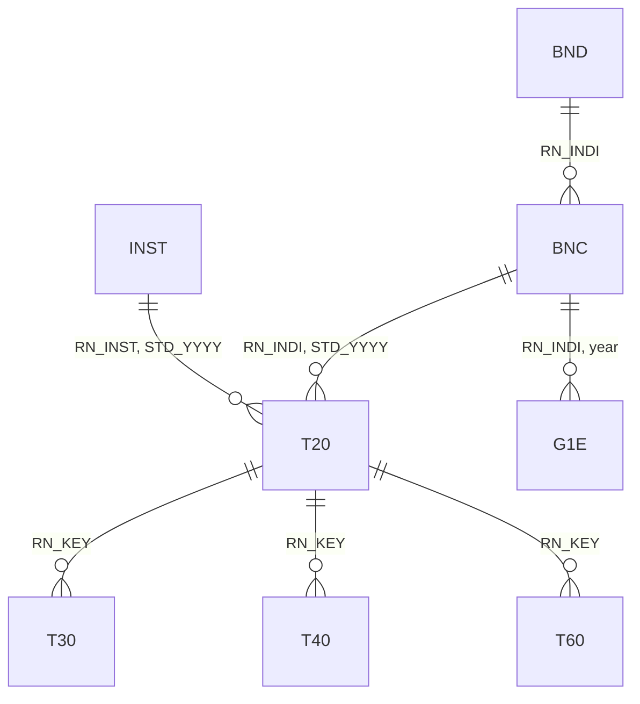

# How the NHIS tables fit together

An NHIS extract arrives as a set of separate tables, and almost every project begins by merging them. Each table describes a different kind of record, such as a person in a year, a claim, or a diagnosis on a claim, and a few identifiers tie the records together. This post explains what one row of each table stands for and which variables to merge on.

<!-- more -->

## What one row stands for

Knowing what one row of a table represents, its unit of observation, is the first step before any merge. The table below lists the unit of each main table in the National Sample Cohort (표본코호트DB).

| Table | 한글 | One row per |
|---|---|---|
| BNC, eligibility and premiums | 자격 및 보험료 | Person and year |
| BND, birth and death | 출생 및 사망 | Person |
| T20, claim statements | 명세서 | Claim |
| T30, treatment details | 진료내역 | Line item on a claim, such as a procedure, a test, or a drug administered at the provider |
| T40, diagnoses | 상병내역 | Diagnosis on a claim |
| T60, prescriptions | 처방전교부상세내역 | Drug on a prescription issued for a pharmacy |
| G1E, general health screening | 건강검진 | Screening |
| INST, healthcare providers | 요양기관 | Provider and year |

The claim statement table T20 is the hub of the claims data. It records the person, the provider, the start date of care, the primary and secondary diagnoses, the days of care, and the amounts, while the other claims tables add detail to each claim.

## The identifiers that link the tables

Three identifiers and a year variable do almost all of the linking between these tables. The cohort databases use other names for the same keys, which are listed in the [variable name crosswalk](../../datasets/index.md).

| Variable | 한글 | English | Found in |
|---|---|---|---|
| `RN_INDI` | 개인고유번호 | Person identifier | Every table except INST and the long-term care facility table T05 |
| `RN_KEY` | 청구고유번호 | Claim identifier | T20, T30, T40, and T60 |
| `RN_INST` | 요양기관고유번호 | Provider identifier | T20 and INST |
| `STD_YYYY` | 기준연도 | Reference year | BNC, T20, and INST |

The diagram shows how the tables connect. Each line joins two tables and is labeled with the merge key, and the fork at one end marks the table with many rows for each value of the key.

## Five merges that cover most analyses

Most analyses need only a handful of merges, and each one has a fixed key.

- **Claims and their details.** T30, T40, and T60 link to T20 on `RN_KEY`. Each claim has many rows in a detail table, so the merged data have one row per line item, diagnosis, or drug.
- **Claims and people.** T20 links to BNC on `RN_INDI` and `STD_YYYY`. The eligibility table has one row per person per year, which is why T20 carries its own reference year for this merge.
- **Birth and death.** BND links to BNC on `RN_INDI` alone, since BND has one row per person with the year of birth `BTH_YYYY` (출생년도) and the year and month of death `DTH_YYYYMM` (사망연월).
- **Health screening.** G1E links to BNC on `RN_INDI`, with the year of screening `EXMD_BZ_YYYY` (검진년도) matched to `STD_YYYY`. Most people are invited for screening every two years, so a person-year panel has screening values only in screening years and leaves the other years empty.
- **Providers.** INST links to T20 on `RN_INST` and `STD_YYYY`. Provider characteristics such as the type of institution, the number of beds, and staffing change over time, so the year of the claim matters.

## The merge to avoid

The one merge that almost never makes sense joins two detail tables to each other. T30 and T40 both have many rows per claim, so merging them on `RN_KEY` pairs every line item with every diagnosis on the same claim. A claim with three diagnoses and ten line items becomes thirty rows, and any sum over line items is tripled.

The safe pattern is to collapse each detail table to one row per claim first, for example to an indicator for a diagnosis or a total per claim, and then merge the result onto T20. Counting the rows before and after each merge is a quick check, since a merge that adds information about claims should not change the number of claims. In Stata, `merge 1:1` and `merge m:1` stop with an error when the key is not unique where it should be, which catches this mistake early.

## Shortcuts through the detail tables

The detail tables also carry the person identifier, so some person-level measures can skip T20. T30, T40, and T60 each include `RN_INDI`, and T30 and T40 also include the start date of care `MDCARE_STRT_DT` (요양개시일자). The reference year `STD_YYYY` and the provider identifier `RN_INST` appear only in T20, however, so any measure by reference year or by provider still goes through the claim statement table.

## The long-term care tables

The long-term care tables form a separate group, linked by identifiers of their own.

- The long-term care application identifier `RN_INDI_SEQ` (장기요양신청 일련번호) links the applications and results table T01 (장기요양 신청 및 판정결과), the assessment items table T02 (장기요양 인정조사사항), and the long-term care claims table T04 (장기요양 청구명세서). It is `RN_INDI` followed by a three-digit application number, and the three tables also carry `RN_INDI` for linking to the rest of the database.
- The long-term care facility number `LTC_INST_ID` (장기요양시설번호) links T04 to the facility table T05 (장기요양기관 현황). T05 also carries the reference year and month `STD_YYYYMM` (기준년월), so check how many rows each facility has before merging.

## Files to append first

In the National Sample Cohort, each claims table comes as several files that need to be appended before any merge. The files are split by type of care, namely medical care (M), dental care (D), Korean medicine (K), and pharmacies (P), and each type is split again into periods, such as `NSC2_M20_0215`, `NSC2_M20_1619`, and `NSC2_M20_2023`. The files of one table share the same layout, and the full file list is on the [dataset page](../../variables/nsc/index.md#t20) of the codebook.
