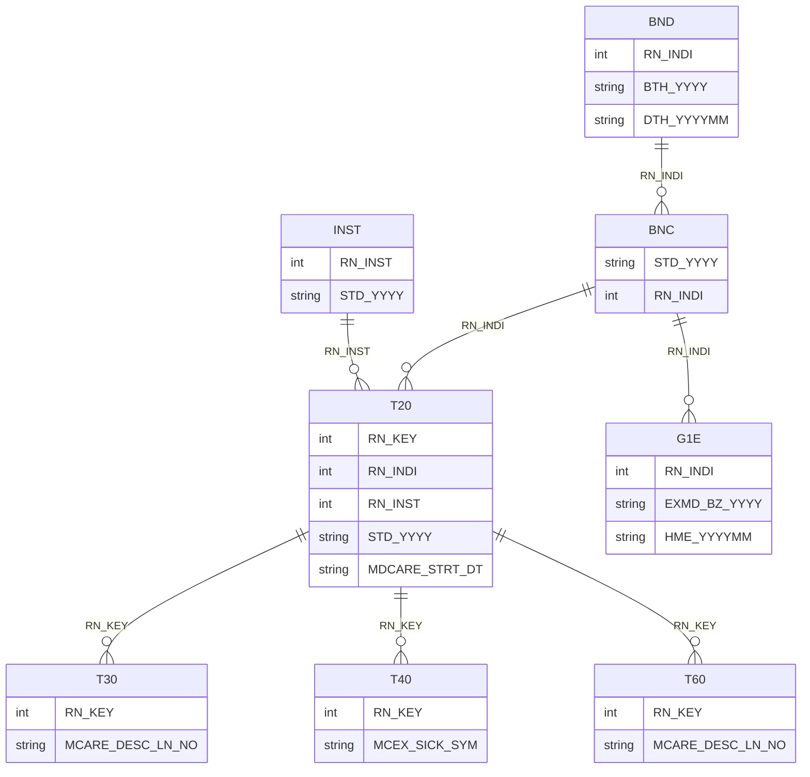

# How the tables fit together

The NHIS databases are relational, with each table at its own unit of observation and a small set of identifiers linking them. Getting the unit of observation right before merging prevents the most common error, which is duplicating rows by merging two tables that are each many-to-one on the key.

The diagram uses the table and variable names of the [National Sample Cohort 2.2](../variables/nsc/index.md). The cohort databases use other names for the same keys, listed in the [variable name crosswalk](../datasets/index.md).

## The claims tables

The claims data come in four tables that share the claim identifier `RN_KEY` (청구고유번호).

- **T20, claim statements (명세서)** has one row per claim, with the person, provider, start date of care, primary and secondary diagnoses, days of care, and amounts.
- **T30, treatment details (진료내역)** has one row per line item on a claim, such as a procedure, test, or drug administered at the provider.
- **T40, diagnoses (상병내역)** has one row per diagnosis on a claim.
- **T60, prescriptions (처방전교부상세내역)** has one row per drug on a prescription issued for a pharmacy.

The T20 table is the hub. Merging T30, T40, or T60 to T20 on `RN_KEY` is a many-to-one merge, while merging T30 to T40 directly on `RN_KEY` pairs every line item with every diagnosis on the claim and should almost never be done.

In the National Sample Cohort, each claims table is delivered as separate files for medical care (M), dental care (D), Korean medicine (K), and pharmacies (P), and each of these is split into periods, such as `NSC2_M20_0215`, `NSC2_M20_1619`, and `NSC2_M20_2023`. The files of one table share the same layout and are appended before use. The file list is on the [dataset page](../variables/nsc/index.md#t20) of the codebook.

## The eligibility and death tables

The eligibility and premium table (BNC, 자격 및 보험료) has one row per person per year, identified by `RN_INDI` (개인고유번호) and `STD_YYYY` (기준년도). Merging claims to eligibility therefore requires both the person and the year, and the T20 table carries its own `STD_YYYY` for this purpose. The birth and death table (BND) has one row per person, with the year of birth and the year and month of death.

## The health screening and provider tables

The general health screening table (G1E) records one screening per row, with the screening year `EXMD_BZ_YYYY` (검진년도) and the year and month of the screening `HME_YYYYMM`. Most people are invited every two years, so a person-year panel has screening values only in screening years, and a merge on `RN_INDI` and the year leaves the other years empty.

The provider table (INST, 요양기관) has one row per provider per year, identified by `RN_INST` (요양기관고유번호) and `STD_YYYY`. Provider characteristics such as the type of institution, number of beds, and staffing change over time, so claims should be merged to the provider table on both the provider and the year of the claim.
